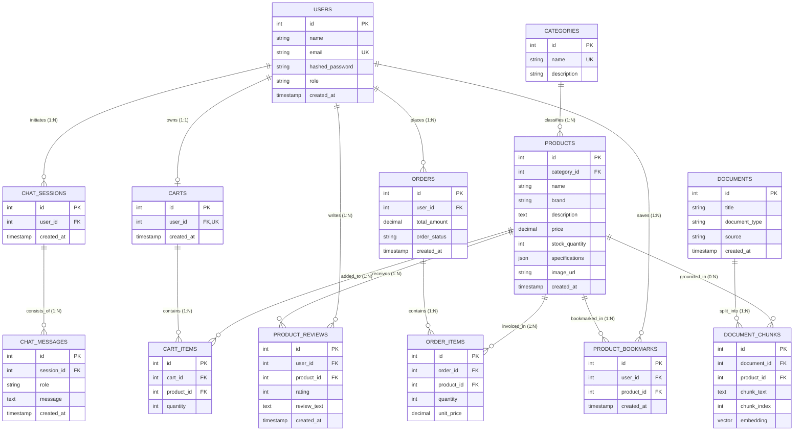

# BuySmart Entity-Relationship (ER) Diagram

---

## Cardinalities & Relational Relationships Summary

1. **User to Cart**: `1 : 1` (Each user has at most one active cart, enforced by `UNIQUE(user_id)`).
2. **User to Orders**: `1 : N` (A user may place zero, one, or many orders; each order belongs to exactly one user).
3. **Category to Products**: `1 : N` (A category groups multiple products; each product belongs to one primary category).
4. **Product to Reviews**: `1 : N` (A product receives multiple reviews; each customer can review each product at most once, enforced by `UNIQUE(user_id, product_id)`).
5. **Cart to Cart Items**: `1 : N` (A cart contains multiple items; duplicate items are consolidated by updating the quantity).
6. **Order to Order Items**: `1 : N` (An order consists of multiple purchased products; historical prices are frozen in `unit_price`).
7. **Document to Document Chunks**: `1 : N` (Knowledge base documents are recursively split into vector chunks).
8. **Chat Session to Chat Messages**: `1 : N` (Ordered chronological conversation turns between customer and assistant).
